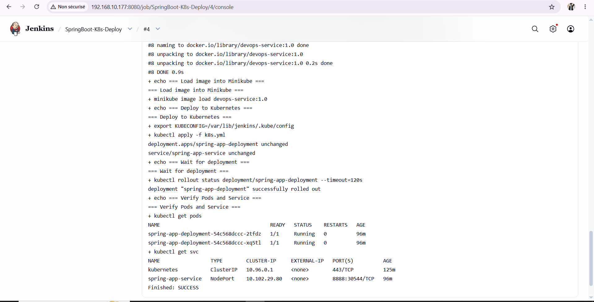
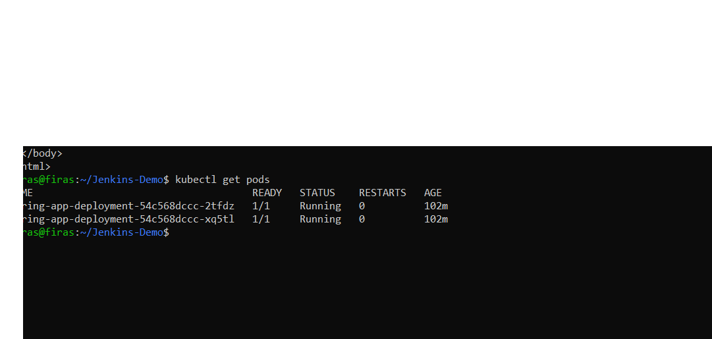
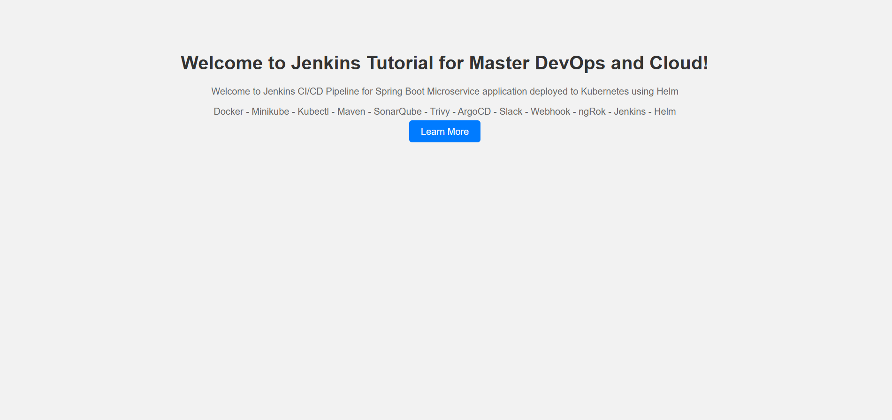

# TP DevOps — CI/CD avec Jenkins, Docker et Kubernetes

## 1. Présentation du projet

Ce TP consiste à automatiser le processus de construction et de déploiement d’une application Spring Boot à l’aide de Jenkins, Docker et Kubernetes (Minikube).

**Objectifs :**
- Récupérer le code source depuis GitHub.
- Compiler l’application avec Maven.
- Construire une image Docker.
- Déployer l’application sur Kubernetes.
- Vérifier le fonctionnement de l’application.

## 2. Architecture du projet

```text
GitHub
  |
  v
Jenkins — Pipeline CI/CD
  |
  +--> Maven : compilation du projet
  |
  +--> Docker : construction de l’image
  |
  +--> Minikube : chargement de l’image
  |
  +--> Kubernetes : déploiement de l’application
                  |
                  +--> 2 Pods Spring Boot
                  |
                  +--> Service NodePort
```

## 3. Environnement technique

- **Système :** Ubuntu Server
- **Gestion du code source :** Git et GitHub
- **Automatisation :** Jenkins
- **Build :** Maven et Java
- **Conteneurisation :** Docker
- **Orchestration :** Kubernetes avec Minikube
- **Application :** Spring Boot

## 4. Structure du dépôt

```text
Jenkins-Demo/
├── src/
├── .mvn/
├── Dockerfile
├── Jenkinsfile
├── k8s.yml
├── mvnw
├── pom.xml
├── README.md
└── screenshots/
    ├── cap1.png
    ├── cap2.png
    └── cap3.png
```

## 5. Étape 1 — Récupération du code source

Le projet est hébergé sur GitHub et utilisé comme source du job Jenkins.

```bash
git clone https://github.com/firaskhdhir11-lab/Jenkins-Demo.git
cd Jenkins-Demo
```

## 6. Étape 2 — Construction de l’application Spring Boot

La compilation est réalisée avec Maven Wrapper :

```bash
chmod +x mvnw
./mvnw clean package -DskipTests
```

Le fichier JAR généré est utilisé ensuite pour construire l’image Docker.

## 7. Étape 3 — Conteneurisation avec Docker

Le `Dockerfile` définit l’environnement d’exécution de l’application.

```dockerfile
FROM eclipse-temurin:17-jre
WORKDIR /app
COPY target/devOpsDemo-0.0.1-SNAPSHOT.jar app.jar
EXPOSE 2222
ENTRYPOINT ["java", "-jar", "app.jar"]
```

Construction de l’image :

```bash
docker build -t devops-service:1.0 .
```

## 8. Étape 4 — Déploiement sur Kubernetes

L’image est chargée dans Minikube, puis les ressources Kubernetes sont appliquées :

```bash
minikube image load devops-service:1.0
kubectl apply -f k8s.yml
kubectl rollout status deployment/spring-app-deployment
```

Vérification des Pods et du Service :

```bash
kubectl get pods
kubectl get svc
```

Le déploiement utilise deux réplicas de l’application et un Service de type NodePort.

## 9. Étape 5 — Configuration de Jenkins

Un job Jenkins Freestyle nommé `SpringBoot-K8s-Deploy` automatise les étapes suivantes :

1. Récupération du code source depuis GitHub.
2. Compilation avec Maven.
3. Construction de l’image Docker.
4. Chargement de l’image dans Minikube.
5. Application des manifestes Kubernetes.
6. Vérification du déploiement.

Le script d’exécution du job est le suivant :

```bash
set -e

echo "=== Java version ==="
java -version

echo "=== Build Spring Boot ==="
chmod +x mvnw
./mvnw clean package -DskipTests

echo "=== Build Docker image ==="
docker build -t devops-service:1.0 .

echo "=== Load image into Minikube ==="
minikube image load devops-service:1.0

echo "=== Deploy to Kubernetes ==="
export KUBECONFIG=/var/lib/jenkins/.kube/config
kubectl apply -f k8s.yml

echo "=== Wait for deployment ==="
kubectl rollout status deployment/spring-app-deployment --timeout=120s

echo "=== Verify Pods and Service ==="
kubectl get pods
kubectl get svc
```

## 10. Résultats et captures d’écran

### 10.1. Exécution réussie du job Jenkins

La capture présente le résultat de l’exécution du job Jenkins.



### 10.2. Vérification des Pods Kubernetes

La capture présente l’état des Pods de l’application après le déploiement.



### 10.3. Vérification de l’application web

La capture présente l’application Spring Boot accessible depuis le navigateur.



## 11. Accès à l’application

Dans l’environnement de test, l’application est accessible depuis le réseau local à l’adresse suivante, lorsque le transfert de port est actif :

`http://192.168.10.177:8888`

Le message attendu est :

**Welcome to Jenkins Tutorial for Master DevOps and Cloud!**

## 12. Conclusion

Ce TP permet de mettre en pratique une chaîne de déploiement automatisée intégrant GitHub, Jenkins, Maven, Docker et Kubernetes. La compilation, la création de l’image, le déploiement et la vérification de l’application sont regroupés dans un job Jenkins reproductible.

